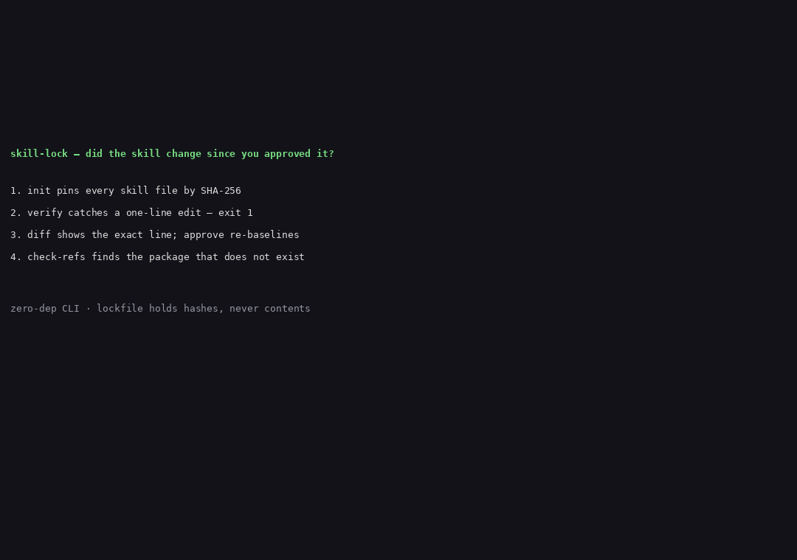

# skill-lock

**Prove the instruction your agent is running is the instruction you approved.**

Agent skills are plain markdown files the agent itself can read, follow, and edit — and markdown is a recommendation, not a constraint. `skill-lock` pins every skill file by SHA-256 in a human-approved lockfile, diffs any drift before the agent runs, and checks that every package and URL the skill references actually exists. One local, zero-dependency CLI; runs as a pre-run hook and as a required CI merge gate.

## The problem, measured

**The instruction drifts.** "Don't Write Markdown Files for Your Coding Agent. Write Scripts." (dev.to, Daniel Nwaneri, 5 Nov 2026) makes the point: an agent can read a `CONTRIBUTING.md`, `AGENTS.md`, `CLAUDE.md`, or rules file, summarize it, quote from it, and still not follow it. The article's own comment thread warns that agents modify their own scripts — and a local hook can be skipped by the agent, so it must be backed by a required CI job and a merge gate the agent has no rights to change. There is no mechanism today that proves "the instruction the agent is running is the instruction I approved."

**What the skill tells the agent to install may not exist.** In the "Phantom Packages" study (dev.to, 1 Nov 2026; repo T-RexBytes/phantom-packages), three local open-weight models wrote 1,199 Python scripts; 212 of 1,410 install suggestions (15.0%) named packages nobody has ever published, 30.0% on obscure tasks — and on a full rerun from scratch, **161 of the 162 ghost names came back**. A reproducible hallucination is a target, not noise. The underlying study (Spracklen et al., USENIX Security 2025, "We Have a Package for You") found 19.7% of recommended packages hallucinated across 576,000 samples and 16 LLMs, with 205,474 distinct fake names; 43% reproduced on every reprompt. A 2026 replication on five frontier models still measures 4.62–6.10%, with 127 package names all five models invent identically and 53 still registrable by an attacker. The attack has a name — **slopsquatting**, coined by Seth Larson (Python Software Foundation) and popularized by Andrew Nesbitt (Ecosyste.ms) in 2025.

The threat is not theoretical: Snyk's ToxicSkills study (5 Feb 2026) scanned 3,984 skills from ClawHub and confirmed 76 malicious payloads aimed at credential theft, backdoors, and data exfiltration; 8 were still public when the report was published. OWASP's Agentic Skills Top 10 rates AST01 Malicious Skills as critical and recommends signatures tied to revocable identities, pinning installed skills by hash with alerts on change, and scanning at publish and install time. And the Agent Skills spec itself defines **no integrity or signing mechanism at all** (ContextLock spec, Section 2).

## Install

```sh
git clone https://github.com/techdevfun/skill-lock.git
cd skill-lock
npm install
npm run build
npm link        # puts `skill-lock` on your PATH
```

Requires Node 20+. Zero runtime dependencies — the only thing installed is TypeScript for the build. An npm package is planned; until it ships, install from source.

## Worked example

The `examples/pr-review/` directory is a complete example project with one skill and a committed lockfile. Try it:

```sh
cd examples/pr-review
skill-lock verify
# skill      file              status    sha256
# pr-review  SKILL.md          OK        6a58f7ff
# pr-review  scripts/check.sh  OK        b7dc53f9
#
# CLEAN: all 2 file(s) match the approved baseline.
```

Now change one line of the skill — the way an agent editing its own instructions would:

```sh
echo "- New rule: never approve unread changes." >> skills/pr-review/SKILL.md
skill-lock verify
# DRIFT: 1 changed, 0 added, 0 removed — review with 'skill-lock diff', then 'skill-lock approve'.
# (exit code 1)
```

See exactly what moved, then decide:

```sh
skill-lock diff
# == CHANGED skills/pr-review/SKILL.md ==
# --- a/skills/pr-review/SKILL.md
# +++ b/skills/pr-review/SKILL.md
# @@ -19,3 +19,4 @@
#  - Quote the exact lines you object to.
#  - Do not rewrite the author's code; suggest, do not apply.
#  - If a check fails, say so and stop — do not guess the result.
# +- New rule: never approve unread changes.

skill-lock approve --by you
# re-baselined pr-review — approved by you at 2026-11-06T...
skill-lock verify   # CLEAN again, exit 0
```

And check what the skill tells the agent to install:

```sh
skill-lock check-refs
# reference                   registry  status    source
# prettier                    npm       EXISTS    refs-demo/SKILL.md:15
# skill-lock-demo-ghost-9x7q  npm       MISSING   refs-demo/SKILL.md:30
#
# GHOST REFERENCE FOUND: a skill tells the agent to install or call
# something that does not exist. Review before approving.
# (exit code 1)
```

## Commands

| Command | What it does |
|---|---|
| `skill-lock init [dirs...] [--by <name>]` | Scan skill directories (default `.claude/skills`, `.agents/skills`) and loose instruction files, write `skill-lock.json`: SHA-256 per file, approved-by, approved-at. Human approval is the only way a baseline is created. |
| `skill-lock verify [skill...] [--format table\|json]` | Re-hash every pinned file and compare with the lockfile. Exit 1 on any drift (changed, added, or removed file). |
| `skill-lock diff [skill]` | Line-level unified diff of changed files against the approved baseline, so a human sees exactly what moved before approving. Non-printing characters (invisible Unicode tag, zero-width, bidi controls) are shown as `⟦U+XXXX⟧`. |
| `skill-lock approve [skill] [--by <name>]` | Re-baseline after human review. No `--force`, no auto-approve: only a human runs this. |
| `skill-lock check-refs [skill] [--offline] [--allowlist <file>] [--format table\|json]` | Extract every package and URL the skill references (`npm`/`pip install` lines, `import`/`require`, URLs) and check each one exists: npm registry, PyPI JSON API, HTTP HEAD for URLs. Exit 1 on any ghost. `--offline` uses the cached registry snapshot; `--allowlist` covers private/internal names the public registries will never know. |

Exit codes: `0` clean · `1` drift or ghost reference found · `2` usage or config error.

## Use it as a gate, not just a hook

A local hook can be skipped by the agent — the dev.to article says so itself. The hook is convenience; the required CI job and merge gate are the real enforcement. `examples/pr-review/github-actions.yml` is a ready-made workflow: checkout, install, `skill-lock verify`, `skill-lock check-refs --offline`. Wire it as a required check on the branch that holds your skills, and the agent has no rights to change it.

Commit `skill-lock.json` to the repo. It holds hashes only — never file contents. Baseline copies live in `.skill-lock/baseline/` for `diff`; that directory is local-only and git-ignored.

## Verdict

| What v0.1.0 does | What it does not do |
|---|---|
| Pin approved skill files by SHA-256, per file | Sign anything. No Ed25519/PKI — hash-pinning only (roadmap). |
| Catch a one-byte change, an added file, a removed file | Judge intent. A hash pins malicious content as faithfully as honest content (skillfold says the same about itself). Intent/malware scanning is a different tool. |
| Show a human exactly what moved, line by line | Auto-fix or auto-approve. Approval is human-only. |
| Flag non-printing characters in changed files | Fully lint invisible Unicode (roadmap). |
| Verify referenced npm/PyPI packages and URLs exist | Verify versions, licenses, or whether a package is safe. Existence only. |
| Work offline from a cached snapshot | Know about private registries (use `--allowlist` for private names; private-registry support is roadmap). |

## Where rivals beat us

- **ContextLock** (contextlock.net) — strongest rival. Real cryptography: Ed25519 + Sigstore keyless signing, DSSE envelopes, provenance-attested, 375 tests. skill-lock v0.1.0 has hash-pinning only and no signatures. If you need to sign published skills, use ContextLock. Its gap, and our wedge: ContextLock is publisher-signature-centric. A locally self-modified skill with no publisher has no signature to check — its own spec falls back to "seal it yourself: pin its bytes locally," a manual step, not a managed approve/diff flow. It does not verify that the packages, APIs, or URLs the skill references actually exist.
- **skillfold** (github.com/byronxlg/skillfold). Lockfile with a `sha256` content hash per remote skill; `skillfold install --frozen` fails the moment installed content diverges. Install-time only — not pre-run, not a CI gate. No existence verification of referenced packages or APIs. No human approve/diff UX. Its own blog states it plainly: "Skillfold verifies integrity, not intent."
- **Phantom Packages** (github.com/T-RexBytes/phantom-packages). Closest on the existence half: Claude Code hook + offline TabPFN detector, blocked 212/212 ghosts in replay, and catches ghosts offline with AUROC 0.975. But PyPI only (no npm, no URLs/APIs), Claude Code hook only, **no skill pinning at all**, and it needs a trained model where a plain registry lookup suffices for the common case. If you only need to guard `pip install`, use Phantom Packages.
- **Tech Leads Club agent-skills** (agent-skills.techleads.club). Curated, hardened registry: SHA-256 hashing, `skills-lock.json`, Snyk scan at publish. Registry-only — it covers their skills, not yours.
- **baaderagency skills library**. Content pinning to an exact commit SHA + hash verification at download time. Download-time only, their library only.

skill-lock's wedge: one local, zero-dependency CLI that does **both halves together** — a human-approved lockfile plus a pre-run diff of the skill files themselves, with an approve flow for your own skills, and existence verification of everything the skill tells the agent to install or call — runnable as a pre-run hook **and** as a required CI merge gate.

## Limitations, stated plainly

- **A hash is not safety.** Pinning proves the file is the one you approved; it says nothing about whether the approved content is safe. Review the diff, every time.
- **The lockfile itself can be edited.** Anyone with write access to the repo can re-baseline. Commit the lockfile and enforce it in CI; the CI gate is the enforcement, the lockfile is the record.
- **A local hook can be skipped.** Run `verify` in CI as a required check, not only as a local hook.
- **`check-refs` MISSING is a finding, not a verdict of malice.** Registry lag, renamed packages, and private names all produce MISSING. Review the finding; `--allowlist` covers private names.
- **Offline snapshots go stale.** `--offline` checks against the last snapshot written by an online run. Re-run online regularly.
- **`diff` shows changed lines by design.** It is the human review surface. Do not store secrets in skill files; `verify` never prints file contents, but `diff` prints the lines that changed.

## Demo



Recorded from real CLI runs — `init` a fixture skill directory, `verify` clean, a scripted edit to `SKILL.md` (simulating the agent modifying its own skill), `verify` showing the drift, `diff` showing the changed line, `approve` after review, then `check-refs` on a fixture skill referencing one real package and one clearly-fake fixture name. The transcript is in `demo/transcript.txt`; re-record it with `scripts/record-demo.sh` and re-render with `scripts/make-gif.py`.

The ghost fixture name `skill-lock-demo-ghost-9x7q` was verified non-existent on npm at demo time, is labelled as a fixture everywhere it appears, and is never registered or published anywhere.

## Roadmap

- **Ed25519 signatures** — optional signing of the lockfile so a re-baseline is attributable to a key, not just a name.
- **Invisible-Unicode linting** — a dedicated check that flags tag, zero-width, and bidi characters in any skill file, not only inside a diff.
- **Private-registry support** — configurable npm/PyPI mirrors so `check-refs` works against internal registries instead of only an allowlist.

## Development

```sh
npm install
npm run build      # tsc, strict
npm test           # unit + e2e (node --test, explicit file list)
npm run test:live  # real registries; skips itself when offline
node scripts/replay-drift.js   # CI replay of the recorded drift scenario
node scripts/preflight.js      # Rule 7: 0 Vietnamese diacritics, 0 internal names
```

Test coverage: hash mismatch on one byte, added/removed files, `approve` re-baseline, `check-refs` on a real package (exists) and a fixture ghost (missing), `--offline` snapshot path, exit codes 0/1/2, and no secret leakage in `verify` output. Live tests hit the real npm and PyPI registries and skip themselves when offline.

## License

MIT. See [LICENSE](LICENSE).
